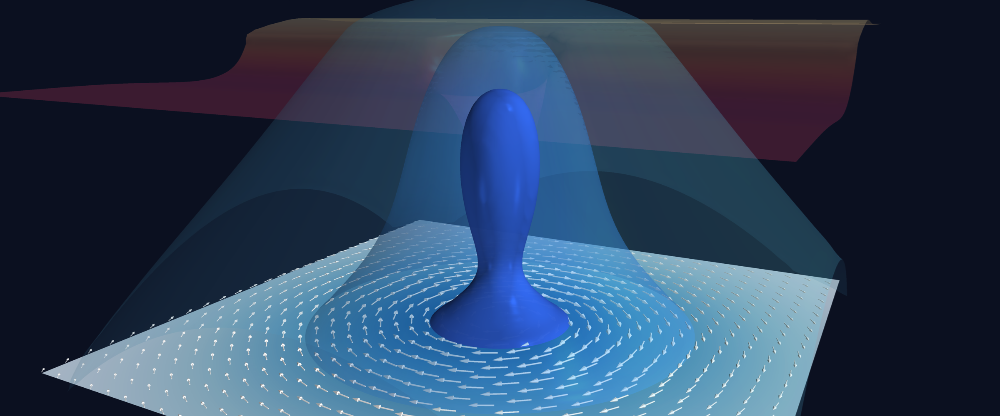
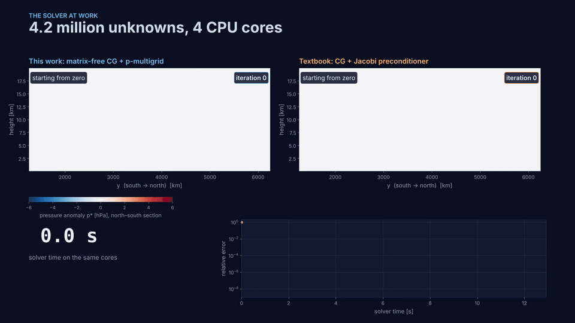
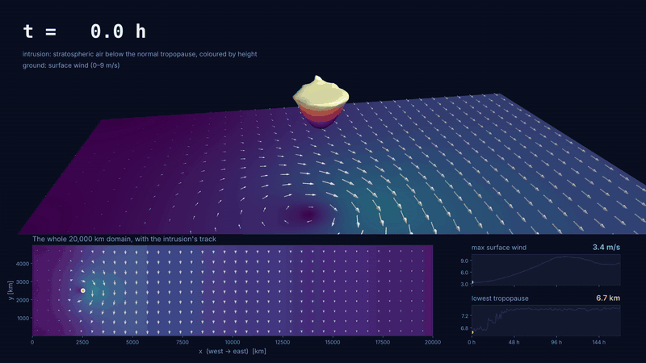
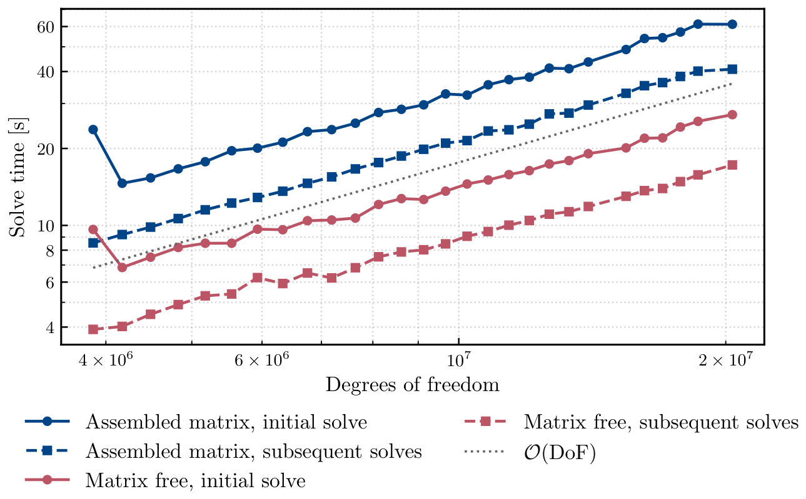
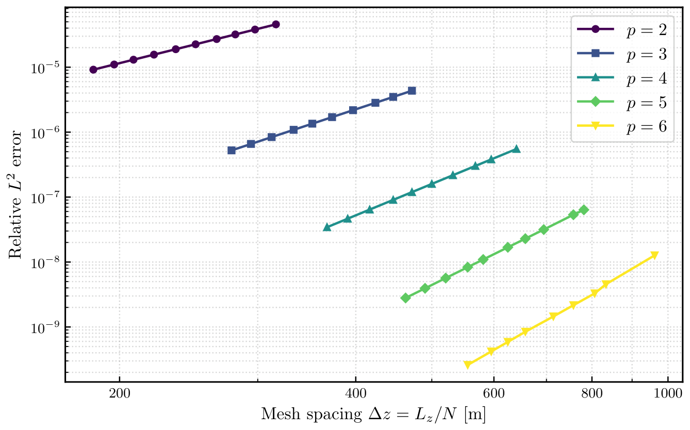

<h1 align="center">PV-Inversion</h1>

<p align="center">
  <b>How far down does a stratospheric intrusion reach, and what does it do to the weather at the ground?</b><br>
  A fifth-order finite element solver for quasigeostrophic potential vorticity inversion and evolution, built with Firedrake.
</p>

<p align="center">
  <a href="docs/thesis.pdf"></a>
  
  
  
  
</p>

<p align="center">
  
</p>

<p align="center">
  <b><a href="docs/thesis.pdf">📄 Read the full thesis (PDF)</a></b> &nbsp;·&nbsp;
  <b><a href="docs/media/diagnostic_solver.mp4">🎬 Diagnostic solver video</a></b> &nbsp;·&nbsp;
  <b><a href="docs/media/prognostic_solver.mp4">🎬 Prognostic solver video</a></b>
</p>

---

## In a nutshell

**Cut-off lows** cause a large share of the extreme rainfall and flash flooding over South Africa. At the core of
each one is a **stratospheric intrusion**: a tongue of high potential vorticity (PV) air that dips from the stratosphere
deep into the troposphere. Whether the storm reaches the surface depends on how far down that intrusion's influence
extends.

PV has a remarkable property: given its distribution, you can **invert** it to recover the wind, pressure and
temperature everywhere. Under the quasigeostrophic approximation the inversion is a 3D elliptic PDE for the
streamfunction $\psi$:

```math
q = \frac{\partial^2 \psi}{\partial x^2} + \frac{\partial^2 \psi}{\partial y^2}
  + \frac{f_0^2}{\overline{\rho}} \frac{\partial}{\partial z}\left(\frac{\overline{\rho}}{\overline{N}^2}\frac{\partial \psi}{\partial z}\right)
```

This project builds a fast, verified solver for that equation, uses it to run thousands of experiments on idealised
intrusions, and then steps the PV forward in time to watch an intrusion evolve.

## Highlights

- **High-order FEM.** Degree-4 continuous Galerkin elements on extruded hexahedral meshes give fifth-order accuracy,
  verified with the method of manufactured solutions: every convergence slope is within 0.03 of $p+1$.
- **Fast enough for parameter sweeps.** I benchmarked more than 40 solver configurations. The winner is a matrix-free
  conjugate gradient solver with a $p$-multigrid preconditioner that only assembles the $p=1$ coarse operator. It scales
  linearly with problem size, and a full atmospheric state is built, inverted and analysed in under 3 s on the HPC
  cluster. On a 4-core VM, 4.2 million unknowns solve in about 12 s, 23× faster than Jacobi-preconditioned CG.
- **Science at scale.** One-at-a-time sweeps, 1000-state random sampling and a derivative-free optimiser (Py-BOBYQA)
  map how intrusion shape and background state control the surface response. The optimiser found intrusions with
  **about 10× the control state's surface pressure anomaly and wind**.
- **Time evolution.** An upwind discontinuous Galerkin transport scheme with a Zhang–Shu bound-preserving limiter and
  SSPRK3 time stepping, verified at fifth order in space and third order in time, and run to 168 hours on a
  5×10⁷-unknown mesh on the UCT HPC cluster.
- **Parallel throughout.** MPI via PETSc, with SLURM + Apptainer job scripts for the HPC runs.

## The diagnostic solver at work

The same 4.2-million-unknown inversion solved two ways on the same 4 CPU cores. This project's matrix-free
$p$-multigrid CG (left) converges to a relative tolerance of $10^{-9}$ in 11 iterations and 12 s. In that time, textbook
Jacobi-preconditioned CG (right) is still 51% off. It needs 1,628 iterations and 285 s to converge, 23× longer.

<p align="center">
  
</p>

## The prognostic solver at work

The control intrusion, carried by a 35 m/s jet for a week. Each stage of each time step re-runs the 3D inversion above
to turn PV into winds, then advects the PV with those winds, so the week below took 3,792 inversions. The jet carries
the intrusion east, while the jet's PV gradient acts like the planetary β-effect and pulls the cyclone poleward, and a
wave train of new circulations spins up downstream. The run is set in a 5,000 km wide channel with straight walls, and
the cyclone's winds soon press against the southern wall, so the thesis uses this run to show that the scheme stays
stable for a week rather than as a forecast.

<p align="center">
  
</p>

<sub>The animations were re-run for this README at reduced resolution on a 4-core VM. The thesis figures and numbers
come from the full-resolution HPC runs.</sub>

## Results

| | Control state | Optimised for wind | Optimised for pressure |
|---|---:|---:|---:|
| Minimum surface pressure anomaly | −4.58 hPa | −43.4 hPa | **−51.7 hPa** |
| Maximum surface wind | 2.22 m/s | 23.8 m/s | **25.3 m/s** |
| Lowest point of the dynamical tropopause | 6.75 km | 2.91 km | 3.25 km |

- Surface response is governed mainly by **tropopause height** and the **depth and horizontal size** of the intrusion.
  The jet stream, the treatment of the tropopause and the stratospheric stability matter little at the surface.
- Once states outside quasigeostrophic validity are excluded ($\mathrm{Ro} \ge 1$), the minimum height of the dynamical
  tropopause is only weakly to moderately correlated with the surface response.
- The strongest responses sit where the Rossby number is at least 1.5, so those results are qualitative. The thesis
  discusses this limitation in detail.

<table>
  <tr>
    <td width="50%"></td>
    <td width="50%"></td>
  </tr>
  <tr>
    <td><sub>Solve time grows linearly with problem size. Matrix-free beats assembled at every size (UCT HPC).</sub></td>
    <td><sub>Error falls as Δz<sup>p+1</sup> for every polynomial degree tested (method of manufactured solutions).</sub></td>
  </tr>
</table>

## Repository map

| File | What it does |
|---|---|
| `parameters.py` | Physical and solver parameters, including the tuned PETSc options for matrix-free CG + $p$-multigrid |
| `domain_builder.py`, `atmosphere_builder.py`, `barnes_atmosphere.py` | Extruded hexahedral mesh, function spaces and the idealised background atmosphere and PV anomaly |
| `diagnostic_solver.py` | The QGPV inversion: weak form, solvability condition and solver set-up |
| `derived_quantities.py`, `tropopause.py` | Wind, pressure, temperature, Rossby/Froude numbers and the dynamical tropopause from the solution |
| `prognostic_solver.py`, `timestepping.py` | Upwind DG transport, Zhang–Shu limiter, SSPRK3 and the time-stepping driver |
| `mms_checker.py`, `prognostic_mms_checker.py`, `error_convergence.py` | Method-of-manufactured-solutions verification |
| `time_complexity.py`, `variator.py`, `param_sampler.py` | Scaling benchmarks, one-at-a-time sweeps, random sampling and the Py-BOBYQA optimiser |
| `slurm_jobs/` | SLURM + Apptainer job scripts for the UCT HPC cluster |
| `showcase/` | AI-generated scripts that captured the solver runs and rendered the videos and animations in this README (not part of the thesis code) |
| `tex/` | LaTeX source of the thesis |

## Running it

Firedrake and its PETSc stack are easiest to get from the official Docker image:

```bash
docker run --rm -it -v "$PWD":/work -w /work -e PYTHONPATH=/work \
    firedrakeproject/firedrake-vanilla-default:latest bash

# inside the container: invert the control state on 4 MPI ranks (N = 40 cells per side, p = 4)
mpiexec -n 4 python3 showcase/smoke_test.py 40 4

# unit and verification tests
python3 tests.py
```

The optimiser needs `pip install Py-BOBYQA`, and the thesis plotting scripts render text with LaTeX. To rebuild the
videos and animations, see [`showcase/README.md`](showcase/README.md).

## Acknowledgements

Honours thesis in the Department of Mathematics and Applied Mathematics, University of Cape Town, supervised by
Dr. Stefaan Conradie. Heavy computations used the University of Cape Town's ICTS High Performance Computing facility
([hpc.uct.ac.za](https://hpc.uct.ac.za)). The idealised set-up follows Barnes et al. (2022), Fehlmann (1997) and
Sprenger (2007).
